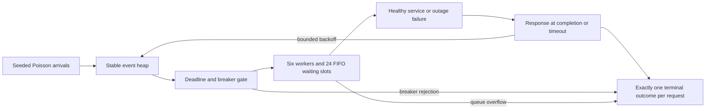

# Architecture and experiment contract

## Workload and queue

Arrivals occur for 120 simulated seconds; response events drain afterward. Healthy
and outage rates are 4/s, overload 80/s. Interarrival times are exponential. Six
workers provide approximately 50 healthy attempts/s at mean service 0.12s; healthy
service draws are uniform 0.08–0.16s. All policies share arrivals and pre-drawn
per-request/per-attempt demands within each scenario/seed.

The outage is [40,70), evaluated at **service start**. Affected attempts reserve 2s
and fail, even if they finish after recovery. No wall-clock sleep or networking occurs.

Each attempt reserves the earliest available worker: start = max(admission time,
worker availability). A second heap tracks future starts. At most 24 admitted attempts
wait, in addition to six running. A start equal to now no longer counts as waiting.
If all workers are busy and the waiting limit is reached, the attempt is rejected
and its original request terminates immediately **without retry**. A zero-slot queue
admits only immediately runnable work.

Client timeout includes queue time and **does not cancel queued or running work**.
Reservations remain until service start/completion even after the client terminates.
Reserved work includes that abandoned work; it is neither CPU utilization nor useful
work. The last reserved completion timestamp reveals remaining dependency backlog.

## Policies and deadlines

| Policy | Attempt timeout | Retries | Total request budget | Breaker |
|---|---:|---:|---:|---|
| Baseline | 3s | 0 | 3s | None |
| Bounded | 0.45s | 2 | 1.65s | None |
| Breaker | 0.45s | 2 | 1.65s | Five consecutive observed failures |

Backoffs are 0.1s and 0.2s. The default total budget equals all allowed attempt
timeouts plus backoffs. Custom policies may specify a shorter deadline. Responses
are clipped to the absolute request deadline; a backoff crossing it terminates at
the deadline with no additional dependency admission. Queue/breaker rejections may
terminate sooner. Every original request gets exactly one terminal outcome.

The breaker opens for 5s after five consecutive current-generation failures.
Success resets the failure streak. The next attempt after cooldown transitions to
half-open and becomes the sole probe; other half-open traffic is rejected. Probe
success closes the breaker; failure reopens it. A probe rejected by the full queue
also reopens because dependency health remains unknown. Generation tokens stop
pre-open responses from mutating new breaker state, while those responses still
determine their own request outcomes.

Events at identical times use insertion order. Initial arrival events are inserted
before later-generated response events; an arrival at a failure response's timestamp
can be admitted before that response opens the breaker. This deterministic convention
is tested and is not a distributed-concurrency claim.

## Audit surface and validation

`simulate(..., trace=True)` includes ordered attempt requests/admissions/responses,
breaker transitions and individual terminal outcomes. Explicit `arrivals` and
`demands` support hand-computable fixtures. Inputs reject malformed, negative,
non-finite and inappropriate boolean/fractional values. Non-finite derived budgets,
deadlines, reservation ends, cooldown ends and accumulated work raise `ValueError`.
Generated workloads are capped at one million expected/actual requests. Runtime
assertions guard duplicate completion, conservation and per-request deadline bounds.

## Limits

One process, one shared breaker, one dependency, fixed capacity and one contiguous
outage. No real model inference, persistent data, cancellation, autoscaling, jitter,
adaptive traffic, multiple regions, distributed breaker coordination, or monetary
costs. Retries assume idempotency. A real fleet can synchronize retries and run many
independent breakers. Demand generation uses Python's `random`; byte reproduction
is verified on the recorded interpreter, not guaranteed across all versions.

Policy settings change timeout and retries together and are not an isolated causal
experiment. Queue size 24 is an illustrative fixed assumption, not an optimized
capacity plan. Three primary and ten additional seeds are descriptive. No production
SLO, RTO/RPO, audit certification or measured failover can be inferred. Next useful
experiments vary queue/cancellation/timeout settings, then validate with an isolated
real dependency and owner-approved service objectives.
