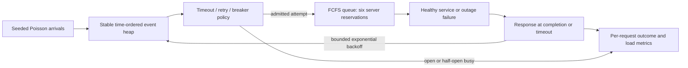

# Architecture and experiment contract

## Workload

Requests arrive for 120 simulated seconds; response events are drained afterward.
Interarrival times are exponential. Healthy and outage traffic average 4 requests/s;
overload averages 80 requests/s. Six identical workers provide approximately 50
healthy attempts/s at the 0.12s mean service demand. Each healthy demand is uniform
0.08–0.16 seconds. No wall-clock sleeps or networking occur.

The outage is [40,70) seconds, evaluated at **service start**, and makes an attempt
take 2 seconds and fail. An attempt starting before recovery still fails afterward.
Service demands are pre-drawn for three attempts per request so policy decisions do
not change the common arrival stream or healthy service draws.

The worker min-heap assigns each admitted attempt to the earliest available worker,
with FIFO ties resolved by the event sequence number. Start = max(attempt time,
worker available time). The queue is unbounded. A client timeout includes queue
waiting time; it does **not** cancel reserved or running dependency work. This models
a dependency with ineffective cancellation and is central to the amplification result.
`dependency_work_s` includes all reserved service, even work after traffic ends;
`last_reserved_completion_s` exposes that backlog. Neither is CPU utilization.

## Policies

| Policy | Per-attempt timeout | Retries | Breaker |
|---|---:|---:|---|
| Baseline | 3s | 0 | None |
| Bounded | 0.45s | 2 | None |
| Breaker | 0.45s | 2 | Open after 5 consecutive observed failures |

Backoffs are 0.1s then 0.2s. A successful response terminates the request; otherwise
it retries until the bound. Breaker rejections terminate immediately and are failures
in availability. Breaker cooldown is 5s, then one half-open probe is allowed; all
other attempts are rejected until its response. A successful probe closes the
breaker; a failed probe reopens it. Generation tokens prevent pre-open responses
from changing the new breaker's state. A probe may itself follow queue reservations.
The bound on terminal time is 3s for baseline, 1.65s for bounded/breaker.

## Limits and next experiments

This is a single process, one shared breaker, one dependency, fixed service capacity,
and one contiguous outage. It excludes network partitions, correlated multiple
dependencies, autoscaling, cancellation, finite queues, adaptive traffic, jitter,
idempotency errors, regional failover and cost modeling. Retries assume idempotent
operations. A distributed fleet may synchronize retries and have separate breakers.
The event ordering at exact timestamp ties is deterministic, not a concurrency model.
Arrival generation uses Python's `random` implementation; byte-for-byte evidence is
verified on the stated interpreter, not promised across every Python version.

Policy comparisons combine timeout and breaker choices; they are not a calibrated
production configuration or exhaustive parameter search. No RTO/RPO, capacity plan,
or statistical significance can be inferred. Next: sweep timeout/cooldown/capacity,
increase seeds, measure recovery time explicitly, add bounded queues and cancellation,
then compare against a disposable real service with injected faults.
